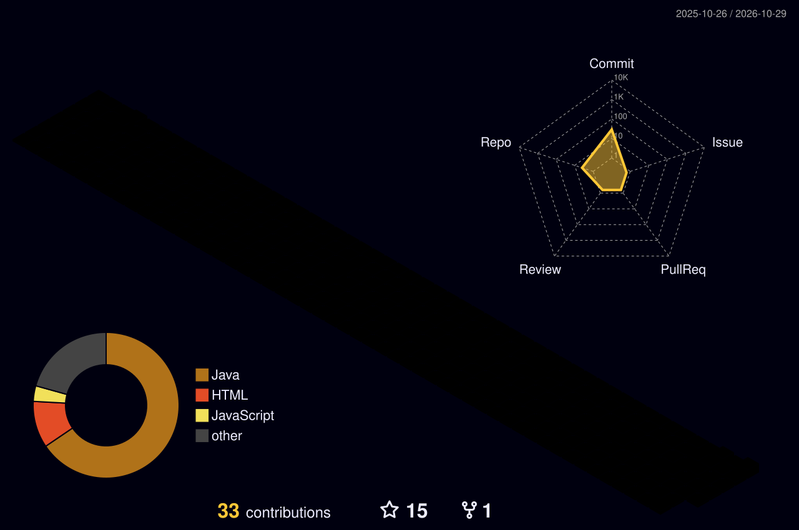

<!-- README de perfil para NatanOliveiraslv -->

<div align="center">
  

  <a href="https://git.io/typing-svg">
    
  </a>

  <p>
    <a href="https://github.com/NatanOliveiraslv"></a>
    <a href="https://www.linkedin.com/in/natan-oliveira-da-silva-3b7365221/"></a>
    <a href="mailto:natanoliveiraslv14@gmail.com"></a>
  </p>
</div>

---

## `$ whoami`

```yaml
nome: Natan Oliveira
área: Desenvolvimento de Software
foco: Backend e Full Stack
base: Java, Spring Boot, Python, Django, JavaScript e React
modo_de_trabalho: investigar → construir → testar → melhorar
status: criando projetos e evoluindo um commit por vez
```

Sou graduado em Ciência da Computação e gosto de transformar ideias em aplicações funcionais. Tenho experiência prática em projetos pessoais e acadêmicos envolvendo APIs, autenticação, bancos de dados relacionais e integração entre frontend e backend.

Minha experiência profissional em tecnologia também me trouxe prática em investigação de incidentes, análise de logs, integrações e documentação técnica. Gosto de entender a causa de um problema, explorar alternativas e aprender construindo.

## 🧰 Ferramentas no meu radar

<div align="center">
  
</div>

<details>
  <summary><strong>O que costumo explorar no desenvolvimento</strong></summary>
  <br />

  - **Backend:** APIs REST, autenticação e autorização, regras de negócio e tratamento de exceções.
  - **Dados:** SQL e bancos de dados relacionais.
  - **Frontend:** interfaces web com React e JavaScript.
  - **Qualidade e colaboração:** Git, documentação técnica, testes e investigação de falhas.
</details>

## 🧪 Status atual

<table>
  <tr>
    <td width="50%" valign="top">
      <strong>🔭 Construindo</strong><br />
      Um projeto de acesso remoto a desktops, com agente, servidor e cliente web, explorando comunicação entre componentes e WebSocket.
    </td>
    <td width="50%" valign="top">
      <strong>🧠 Meu jeito de aprender</strong><br />
      Parto de um problema, pesquiso possibilidades, implemento uma versão funcional e uso os erros como pistas para melhorar a solução.
    </td>
  </tr>
</table>

## 📡 Telemetria do GitHub

<div align="center">
  
  
</div>

<div align="center">
  
</div>

## 🧊 Meu código em 3D

<div align="center">
  
</div>

<p align="center"><sub>Este painel é gerado automaticamente pelo GitHub Actions e atualizado diariamente.</sub></p>

## 🤝 Vamos trocar ideias?

<div align="center">
  <a href="https://github.com/NatanOliveiraslv">Explore meus repositórios</a> ·
  <a href="https://www.linkedin.com/in/natan-oliveira-da-silva-3b7365221/">Conecte-se no LinkedIn</a> ·
  <a href="mailto:natanoliveiraslv14@gmail.com">Envie um e-mail</a>
  <br /><br />
  
</div>


